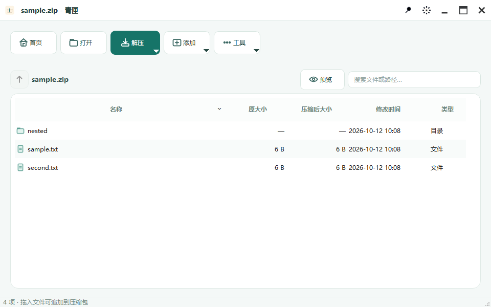

# 青匣 QingXia

一个面向 Windows 的轻量压缩文件管理器。打开压缩包、查看内容、按需解压，也可以通过拖放或资源管理器右键菜单创建压缩包。

> 当前为 **0.1.0 预览版本**。可从 [GitHub Releases](https://github.com/huanglin2/zipDesk/releases/tag/v0.1.0) 下载 Windows x64 安装包或免安装 ZIP；功能和界面仍在完善。




## 功能

- 浏览压缩包目录，按名称或路径搜索、排序，并解压全部或选中项目。
- 创建 ZIP、7z 压缩包；选择压缩级别、设置密码，以及创建分卷压缩包。7z 还支持固实压缩和自解压 EXE（需要 `7z.sfx`）。
- 向 ZIP、7z 添加文件，以及重命名、替换或删除其中的项目。
- 测试压缩包完整性；从**仍可读取目录**的损坏压缩包中逐项抢救文件。
- 预览较小的文本和图片文件，支持窗口内外拖放、最近打开记录及可选的资源管理器集成。
- 提供简体中文界面和部分英文界面文案，以及基础命令行入口。

| 格式 | 打开与解压 | 创建 | 修改内容 |
| --- | :---: | :---: | :---: |
| ZIP | ✓ | ✓ | ✓ |
| 7z | ✓ | ✓ | ✓ |
| RAR | ✓ | — | — |

格式识别目前依赖文件扩展名。分卷压缩包可以创建，但直接打开 `.001` 分卷尚未支持；更多读取格式在[开发计划](PRODUCT_PLAN.md)中。

## 获取与使用

在 [Release 页面](https://github.com/huanglin2/zipDesk/releases/tag/v0.1.0) 下载 `setup.exe` 安装包，或完整解压 `portable.zip` 后运行 `ZipDesk.exe`。两种包均包含 Qt、7-Zip 和 Visual C++ 运行库，另附 SHA-256 校验文件。程序未做代码签名。

启动后，可以拖入 ZIP、7z、RAR 查看内容，或拖入普通文件和文件夹创建压缩包。打开压缩包后，工具栏提供解压、添加和完整性测试等操作。也可以按下文从源码构建。

程序设置中可以启用资源管理器文件关联与右键菜单；安装器也提供此选项。该设置写入当前用户的 Windows 配置，不需要系统级安装。

### 智能解压

在窗口的“解压”菜单中选择“智能解压”，或使用资源管理器青匣菜单中的同名命令：

- 包内只有一个顶层文件夹：解到压缩包旁，保留包内文件夹名，避免重复套一层目录。
- 多个顶层项目或单个文件：解到压缩包同名文件夹。
- 空包：提示没有需要解压的文件，不创建目录。
- 目标有同名文件：询问覆盖、跳过或取消；完成后可直接打开实际内容目录。

已启用过资源管理器集成的用户，需要用新版本重新注册才能看到新增菜单。也可以运行 `ZipDesk.exe --extract-smart "C:\path\example.zip"`。当前智能解压针对单个压缩包。

### 解压结果与文件保护

解压结束会显示目标目录，并提供“打开目标文件夹”。选择“全部跳过”后，完成提示会说明同名文件按跳过规则处理；失败或取消会提示目标目录可能保留部分文件。当前还没有逐项结果清单或精确成功、跳过数量。

取消操作不会递归删除整个新建目标目录；非空目录会保留，以免删除操作期间用户或其他程序放入的文件。解压前也会检查所选输出是否指向源压缩包自身，发现冲突时停止操作。
## 从源码构建

### 环境

- Windows x64、Visual Studio 2022 的 **Desktop development with C++** 工作负载。
- CMake 3.21 或更新版本、Ninja。
- Qt 6 Widgets 开发包；当前开发环境使用 Qt 6.9.1 MSVC 2022 x64。需要运行界面测试时安装 Qt Test。
- 与目标架构一致的 7-Zip `7z.dll`。创建自解压 EXE 时，还需要同目录的 `7z.sfx`。
- 配置时需要网络连接，以获取固定版本的 bit7z 及其构建依赖。

在 **x64 Native Tools Command Prompt for VS 2022** 中运行，并将路径替换为自己的安装位置：

```bat
cmake -S . -B build -G Ninja -DCMAKE_BUILD_TYPE=Release ^
  -DCMAKE_PREFIX_PATH="C:/Qt/6.9.1/msvc2022_64" ^
  -DZIPDESK_7Z_DLL="C:/Program Files/7-Zip/7z.dll"
cmake --build build --parallel
build\ZipDesk.exe
```

构建时会将 `7z.dll` 复制到程序旁，并在找到 `7z.sfx` 时一并复制。若找到 `windeployqt`，构建后也会部署 Qt 运行库。程序启动时必须能在同目录找到 `7z.dll`。

### 运行测试

构建后在仓库根目录运行全部测试：

```bat
ctest --test-dir build --output-on-failure
```

默认启用 CTest。找到 Qt Test 时共注册 15 项测试，覆盖归档服务、压缩对话框、主窗口，以及解压完成、跳过同名文件、取消和失败；智能解压还覆盖顶层目录、混合项目、空包、已有目录冲突及窗口菜单入口。界面测试使用 Windows Qt 平台插件，CTest 会配置 Qt DLL 搜索路径；未安装 Qt Test 时仅运行服务层测试。

### 制作安装包

安装 [Inno Setup](https://jrsoftware.org/isinfo.php) 后，在完成上述构建的前提下运行 PowerShell 打包脚本，将路径改成自己的安装位置：

```powershell
.\scripts\package.ps1 -RuntimeDirectory "C:\Path\To\VC\Redist\MSVC\14.xx\x64\Microsoft.VC143.CRT" -Iscc "C:\Program Files (x86)\Inno Setup 6\ISCC.exe"
```

脚本按白名单收集程序及运行库，加入第三方许可和源提交信息，在 `dist` 生成安装包、免安装 ZIP 和 `SHA256SUMS.txt`。测试程序、构建缓存和本地日志不进入发布包。

## 命令行

以下是当前实现的基础用法；它不是完整的 7-Zip 命令行兼容层。

```bat
build\ZipDesk.exe l example.zip
build\ZipDesk.exe t example.zip
build\ZipDesk.exe x example.zip -oC:\output
build\ZipDesk.exe a result.7z file1.txt folder
```

`l` 列出文件，`t` 测试完整性，`x` 解压，`a` 创建压缩包。还实现了更新、删除和重命名等基础命令；参数行为以 `src/Cli.cpp` 为准。

## 项目结构

- `src/`：归档服务、Qt 界面、命令行及 Windows 资源管理器集成。
- `resources/`：程序图标和界面图片。
- `installer/`：Inno Setup 安装脚本及关联辅助脚本。
- `tests/`：服务层和界面冒烟测试。
- [`PRODUCT_PLAN.md`](PRODUCT_PLAN.md)：当前阶段与后续开发计划。

## 已知限制

- 仅面向 Windows x64；RAR 只支持打开和解压。
- “抢救可读取文件”依赖能够先读取压缩包目录，不能修复所有损坏情况。
- ZIP 密码目前只接受 ASCII 字符；英文界面尚有未翻译文案。
- 解压失败或取消时，目标目录可能保留已写入的部分文件；已经覆盖的文件不会自动恢复。

## 参与开发与许可

欢迎通过 Issue 报告可复现的问题，或通过 Pull Request 提交改进。提交前请运行相关冒烟测试，并说明改动涉及的使用场景。

**项目自身尚未选择开源许可证。** 第三方组件的许可和源码地址见 [THIRD_PARTY_NOTICES.md](THIRD_PARTY_NOTICES.md)，对应许可文本随二进制包分发。
